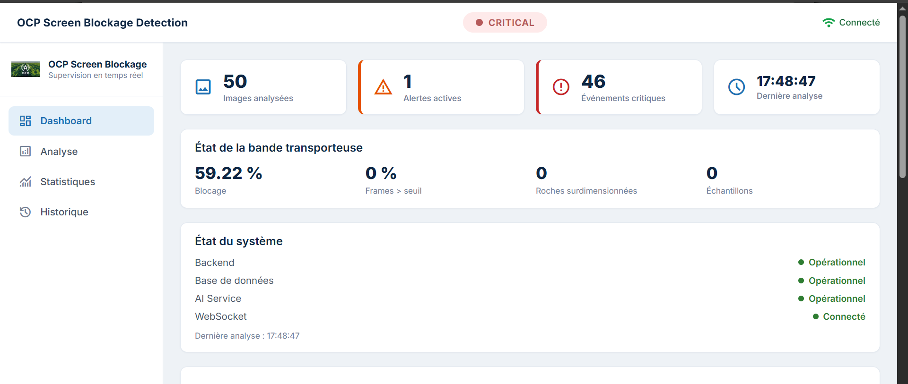
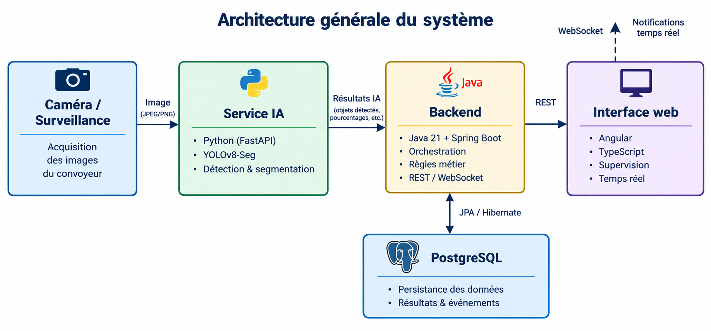
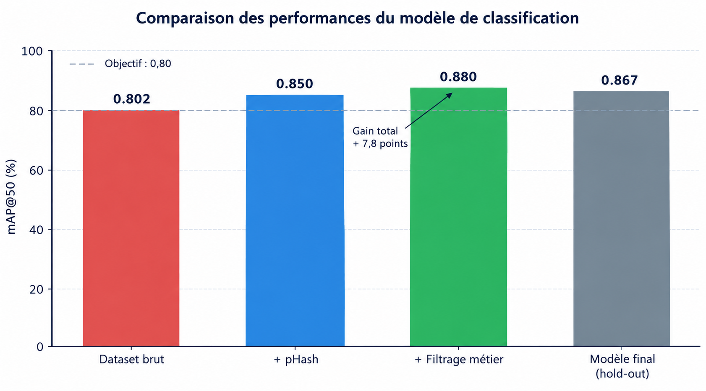

# OCP Screen Blockage Detection

Détection automatique du blocage d'un crible vibrant à partir d'images de caméra, avec supervision en temps réel.

Projet réalisé à la Direction des Systèmes d'Information de l'OCP Group, dans le cadre du Master d'Excellence en Systèmes d'Information et Intelligence Artificielle.



## Contexte

Sur un crible vibrant, l'accumulation de roches dans les mailles réduit le passage de la pulpe et fait perdre de la matière. Ce phénomène est aujourd'hui repéré en partie à l'œil par les opérateurs. L'objectif est de le détecter tôt à partir d'une caméra fixe, sans fausse alerte sur une situation ponctuelle.

## Fonctionnement

Chaque image est segmentée par un modèle YOLOv8-seg, qui mesure la surface occupée par les roches. Le backend confronte ce taux de blocage aux analyses des 300 dernières secondes, puis fixe l'état du crible : `NORMAL`, `WARNING` ou `CRITICAL`. Tout changement d'état est enregistré en base et envoyé en temps réel au tableau de bord. Les seuils (25 % et 50 % par défaut) se règlent dans la configuration, sans modifier le code.

## Points techniques

- **Architecture en services découplés** : le modèle de vision peut être remplacé sans toucher au backend, et inversement.
- **Moteur de décision à fenêtre glissante** : l'état est calculé sur la durée pour éviter les fausses alertes ponctuelles. C'est la partie la plus testée du backend (tests unitaires JUnit).
- **API REST et WebSocket (STOMP)** : analyse à la demande, historique paginé, diffusion en temps réel des changements d'état.
- **Configuration externalisée** : seuils, cadence de capture et paramètres de calibration se modifient sans recompiler.
- **Démarche data-centric** : dédoublonnage pHash, filtrage métier et jeu de test gelé avant tout entraînement.

## Architecture



| Composant | Dossier | Stack | Port |
|---|---|---|---|
| Service d'inférence | [`ai-service`](ai-service) | Python, FastAPI, Ultralytics | 8000 |
| Backend métier | [`backend`](backend) | Java 21, Spring Boot | 8080 |
| Tableau de bord | [`frontend`](frontend) | Angular, TypeScript | 4200 |
| Base de données | | PostgreSQL | 5433 |

Chaque dossier contient son propre README.

## Résultats

Évaluation sur un jeu de test de 10 % des images, isolé avant l'entraînement. Le dataset de 2 242 images a été constitué à partir de quatre jeux de données publics.

| Modèle | mAP50 | Recall | Latence (GPU T4) |
|---|---|---|---|
| YOLOv8n-seg | 0,864 | 0,803 | 12 ms |
| YOLOv8l-seg | 0,867 | 0,796 | 26 ms |

Le nettoyage des données (dédoublonnage pHash, filtrage métier) apporte +7,8 points de mAP50, davantage que le choix d'un modèle plus gros.



## Limites

Il s'agit d'un prototype. Il n'a pas été validé sur des images réelles du site, et le facteur de conversion pixel vers centimètre est une estimation à calibrer avec la caméra définitive. Les seuils de décision restent à recaler avec les exploitants.

## Démarrage rapide

Prérequis : Python 3.10+, Java 21, Node.js, PostgreSQL (port 5433).

Sous Windows, le script suivant lance les trois services :

```powershell
./start_all.ps1
```

Ou service par service :

```bash
# Service IA
cd ai-service && pip install -r requirements.txt
uvicorn main:app --port 8000

# Backend
cd backend && ./mvnw spring-boot:run

# Frontend
cd frontend && npm install && npm start
```

Le tableau de bord est accessible sur http://localhost:4200. En l'absence de caméra, `scripts/camera_simulator.py` rejoue les images de `test-data/`.

## Tests

```bash
cd backend && ./mvnw test
cd frontend && npm test
cd ai-service && pytest tests
```

## Structure

```
ai-service/    Inférence (FastAPI + YOLOv8-seg)
backend/       API REST, moteur de décision, WebSocket
frontend/      Tableau de bord Angular
scripts/       Simulateur de caméra, vérification des services
test-data/     Images d'exemple
docs/          Images du README et guide de démarrage
```

## Auteur

**Otman AMAL** · Master d'Excellence en Systèmes d'Information et Intelligence Artificielle
[otman.amal01@gmail.com](mailto:otman.amal01@gmail.com)