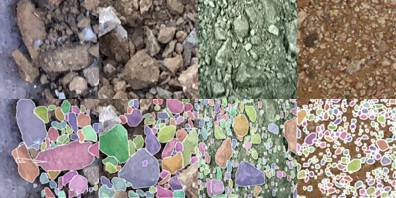
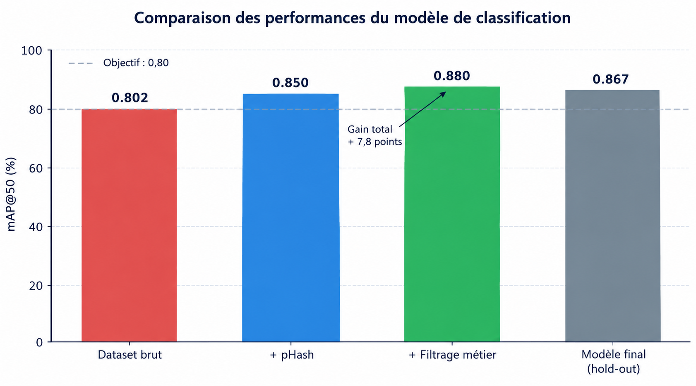
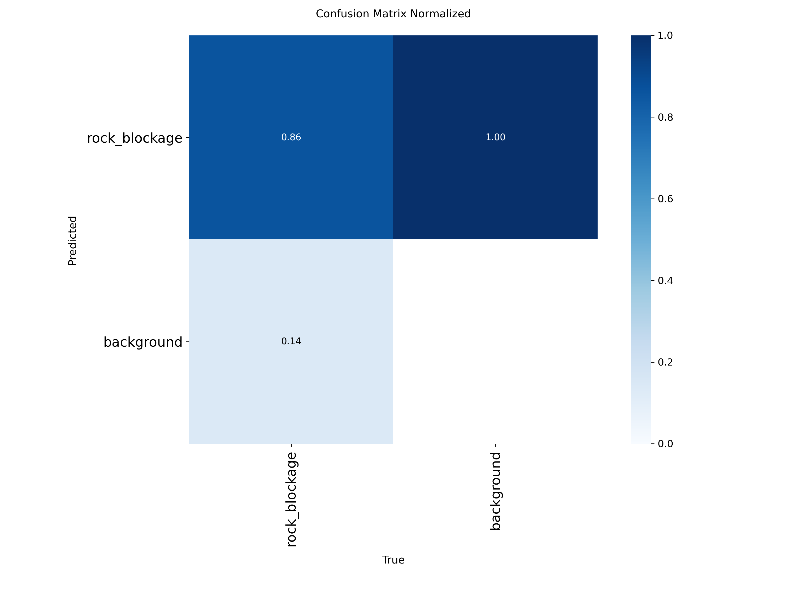

# AI Service

Microservice d'inférence qui détecte et mesure les roches sur une image de crible, avec un modèle de segmentation d'instances YOLOv8-seg. Il est appelé par le [backend](../backend) à chaque image reçue.

Le service se limite à détecter et mesurer. Le passage en `WARNING` ou `CRITICAL` est décidé par le backend, ce qui permet de changer de modèle sans toucher aux règles métier.



## Stack

Python · FastAPI · Ultralytics YOLOv8-seg · OpenCV · PyYAML

## Installation

```powershell
cd ai-service
python -m venv .venv
.\.venv\Scripts\python.exe -m pip install -r requirements.txt
```

On appelle directement le Python du venv, ce qui évite les problèmes de politique d'exécution des scripts d'activation sous Windows. Sous Linux ou macOS, remplacez `.\.venv\Scripts\python.exe` par `./.venv/bin/python`.

## Lancement

```powershell
.\.venv\Scripts\python.exe -m uvicorn main:app --host 127.0.0.1 --port 8000
```

Le service répond ensuite sur http://127.0.0.1:8000. La documentation interactive FastAPI est disponible sur `/docs`.

## API

| Méthode | Route | Rôle |
|---|---|---|
| `GET` | `/` | État du service |
| `POST` | `/analyze` | Analyse d'une image (`multipart/form-data`) |

```powershell
curl.exe -X POST http://127.0.0.1:8000/analyze -F "file=@test_image.jpg"
```

Exemple de réponse (extrait) :

```json
{
  "image_width": 1920,
  "image_height": 1080,
  "blockage_percentage": 23.9,
  "detections": [
    {
      "class_name": "rock_blockage",
      "confidence": 0.91,
      "width_cm": 6.2,
      "height_cm": 4.7,
      "oversized": true,
      "mask": [[512, 340], [530, 338], [548, 351]]
    }
  ]
}
```

`blockage_percentage` correspond à la part de la surface de l'image couverte par l'ensemble des masques. `oversized` vaut `true` lorsqu'une dimension de la roche dépasse le seuil métier de 20 mm.

## Traitement d'une image

1. Validation du fichier (nom et format).
2. Inférence YOLOv8-seg. Le modèle est chargé une seule fois au démarrage du service, pas à chaque requête.
3. Extraction des masques et calcul des dimensions en pixels.
4. Conversion en centimètres avec le facteur de calibration.
5. Calcul du taux de blocage et renvoi du JSON.

## Configuration

Les paramètres sont regroupés dans `config/config.yaml` :

| Clé | Valeur | Rôle |
|---|---|---|
| `modele.fichier` | `yolov8l-seg.pt` | Fichier de poids chargé au démarrage |
| `calibration.cm_per_pixel` | `0.10417` | Facteur de conversion pixel vers centimètre |
| `seuils_metier.seuil_roche_surdimensionnee_mm` | `20` | Seuil à partir duquel une roche est jugée surdimensionnée |
| `capture_interval_seconds` | `30` | Cadence de capture, reprise par le backend |
| `camera_zone_visible`, `camera_specs` | | Hypothèses de géométrie utilisées pour la calibration |

Le facteur de calibration est une estimation géométrique, pas une mesure : il découle de la zone couverte par la caméra (2,0 m de large) et de sa résolution (1920 px). Il doit être recalculé avec la caméra définitive, par exemple à partir d'un objet de taille connue placé dans le champ. Les dimensions du crible et les spécifications de la caméra renseignées dans ce fichier sont des ordres de grandeur, non des données du site.

## Modèle

Le modèle a été entraîné par transfer learning puis fine-tuning sur 2 242 images issues de quatre jeux de données publics, après dédoublonnage pHash et filtrage métier. Un jeu de test de 10 % a été isolé avant l'entraînement.

| Modèle | mAP50 | mAP50-95 | Recall | Latence (GPU T4) |
|---|---|---|---|---|
| YOLOv8n-seg | 0,864 | 0,691 | 0,803 | 12 ms |
| YOLOv8l-seg | 0,867 | 0,710 | 0,796 | 26 ms |

Les deux modèles obtiennent des scores très proches sur le jeu de test. YOLOv8n-seg (environ 6,5 Mo) convient mieux à un déploiement industriel. Ce dépôt embarque YOLOv8l-seg, qui sert de référence, et le modèle utilisé se change dans `modele.fichier`. Sur CPU, YOLOv8l-seg demande environ 4 secondes par image, ce qui reste compatible avec une capture toutes les 30 secondes.

Le gain principal vient des données : le nettoyage fait passer le mAP50 de 0,802 à 0,880 en validation.



Le rappel plafonne autour de 0,80 quel que soit le seuil de confiance. Le modèle manque surtout les petites roches et celles qui sont partiellement cachées.



Pour accélérer l'inférence sur une machine sans GPU, le modèle peut être exporté au format ONNX ou OpenVINO.

## Tests

```powershell
.\.venv\Scripts\python.exe -m pytest tests
```

## Structure

```
main.py        Point d'entrée FastAPI
config/        config.yaml et son chargement
schemas/       Modèles de réponse
services/      Chargement du modèle, inférence, mesures
tests/         Tests du modèle
```

## Limites

Le modèle a été entraîné et évalué uniquement sur des images publiques. Il n'a pas été validé sur des images du site, et ses performances en conditions réelles (poussière, éclairage, angle de caméra) restent à mesurer.