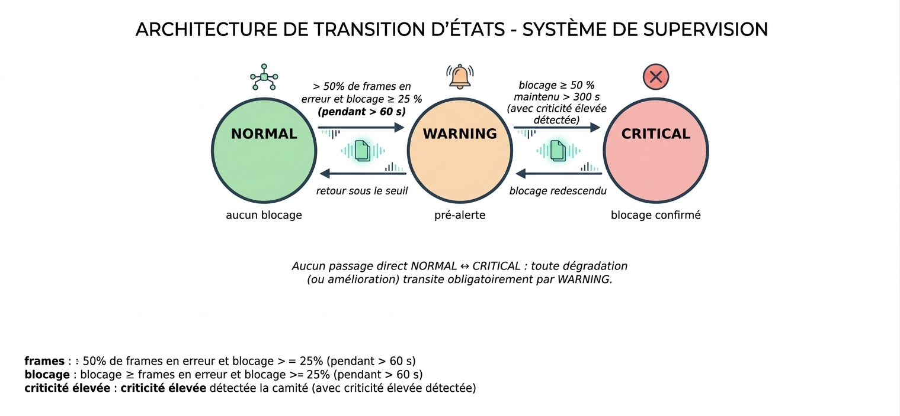

# Backend

API REST et moteur de décision du système. Le backend reçoit les images, les fait analyser par le [service IA](../ai-service), décide de l'état du crible (`NORMAL`, `WARNING` ou `CRITICAL`), enregistre les changements d'état et les diffuse en temps réel au [tableau de bord](../frontend).

Le service IA mesure, le backend décide. Cette séparation permet de faire évoluer le modèle et les règles métier indépendamment.



## Stack

Java 21 · Spring Boot · Spring Data JPA · WebSocket (STOMP) · PostgreSQL · Maven · JUnit

## Prérequis

- Java 21
- PostgreSQL avec une base `ocp_blockage` vide, accessible sur le port 5433. Les tables sont créées au démarrage.
- Service IA démarré sur le port 8000

```sql
CREATE DATABASE ocp_blockage;
```

## Lancement

```powershell
cd backend
.\mvnw.cmd spring-boot:run
```

Sous Linux ou macOS : `./mvnw spring-boot:run`. L'API répond ensuite sur http://localhost:8080.

## API REST

| Méthode | Route | Rôle |
|---|---|---|
| `POST` | `/api/analyses` | Envoie une image (`multipart/form-data`), déclenche l'analyse IA et met à jour l'état |
| `GET` | `/api/analyses` | Liste paginée des analyses |
| `GET` | `/api/analyses/{id}` | Détail d'une analyse : détections, dimensions, masques |
| `GET` | `/api/status` | État courant, recalculé sur la fenêtre (lecture seule) |
| `GET` | `/api/events` | Historique paginé des changements d'état |
| `GET` | `/api/events/latest` | Dernier changement d'état enregistré |

`POST /api/analyses` est le seul point d'entrée de la chaîne : une seule requête par image suffit, et la réponse contient à la fois le résultat de l'analyse et l'état courant. `GET /api/status` ne crée jamais d'événement ni de notification, un simple rafraîchissement de l'écran ne modifie donc pas l'historique.

```powershell
curl.exe -X POST http://localhost:8080/api/analyses -F "file=@../ai-service/test_image.jpg"
```

## Temps réel

Les changements d'état sont publiés sur le topic STOMP `/topic/status`, via l'endpoint WebSocket `/ws`. Un message n'est envoyé qu'au moment exact d'une transition, jamais à chaque analyse.

```json
{
  "status": "CRITICAL",
  "blockagePercentage": 57.4,
  "timestamp": "2026-04-12T14:32:10Z"
}
```

Le message reste minimal. Les détails (détections, masques) se consultent à la demande via l'API REST. Après une reconnexion, le client relit l'état courant avec `GET /api/status`, ce qui évite de dépendre d'un message perdu.

## Moteur de décision

L'état est calculé sur une fenêtre glissante de 300 secondes, soit une dizaine d'analyses à la cadence de capture de 30 secondes. Une image isolée ne peut donc ni déclencher ni lever une alerte à elle seule.

| État courant | Condition sur la fenêtre | Nouvel état |
|---|---|---|
| `NORMAL` | Au moins 50 % des analyses dépassent 25 % de blocage | `WARNING` |
| `WARNING` | Le blocage dépasse 50 % de façon maintenue sur toute la fenêtre | `CRITICAL` |
| `WARNING` | La proportion d'analyses en dépassement retombe | `NORMAL` |
| `CRITICAL` | Le blocage redescend sous le seuil critique | `WARNING` |
| `CRITICAL` | Retour durable sous le seuil d'alerte | `NORMAL` |

Quelques règles de conception :

- Aucun passage direct de `NORMAL` à `CRITICAL`.
- Seule une transition réelle crée un événement en base et une notification.
- Une analyse dont l'horodatage est antérieur à la dernière connue est ignorée, pour ne pas fausser la fenêtre quand une image arrive en retard.
- Si le service IA est indisponible, la fenêtre n'est pas alimentée et l'état précédent est conservé : une panne ne peut pas faire croire à un blocage.

## Configuration

Les seuils et paramètres se règlent dans `src/main/resources/application.yml`, sans recompilation.

| Paramètre | Valeur par défaut | Rôle |
|---|---|---|
| `decision.warning-blockage-percentage` | 25 % | Seuil d'une analyse jugée chargée |
| `decision.critical-blockage-percentage` | 50 % | Seuil de blocage franc |
| `decision.persistence-window-seconds` | 300 s | Durée de la fenêtre glissante |
| `decision.warning-min-frames-ratio` | 0,5 | Part minimale d'analyses en dépassement pour `WARNING` |
| `capture.interval-seconds` | 30 s | Cadence de capture, qui dimensionne la fenêtre |
| `ai-service.read-timeout-ms` | 30 000 ms | Délai maximal de réponse du service IA |
| `spring.servlet.multipart.max-file-size` | 15 Mo | Taille maximale d'une image |
| `server.port` | 8080 | Port du backend |

La connexion à la base et l'adresse du service IA se surchargent par variables d'environnement :

| Variable | Valeur par défaut |
|---|---|
| `POSTGRES_URL` | `jdbc:postgresql://127.0.0.1:5433/ocp_blockage` |
| `POSTGRES_USER` | `postgres` |
| `POSTGRES_PASSWORD` | `postgres` |
| `AI_SERVICE_BASE_URL` | `http://127.0.0.1:8000` |

## Gestion des erreurs

| Situation | Code retourné |
|---|---|
| Image refusée par le service IA (format ou extension invalide) | `502` |
| Réponse du service IA invalide ou inattendue | `502` |
| Service IA indisponible ou délai dépassé | `503` |

## Architecture

```
controller/    Endpoints REST (DetectionController, EventController, StatusController)
dto/           Objets d'échange avec l'interface et le service IA
service/       Règles de décision, fenêtre glissante, client du service IA
repository/    Accès PostgreSQL (EventRepository)
config/        WebSocket, CORS, propriétés du service IA
```

Les contrôleurs ne contiennent aucune règle métier, et les services ne connaissent pas le protocole HTTP. Une seule classe, `AiServiceClient`, dialogue avec le service IA.

## Tests

```powershell
.\mvnw.cmd test
```

Les tests unitaires du moteur de décision concentrent l'effort, car c'est la partie la plus critique. Ils s'exécutent sans base de données ni service IA, avec des séries de mesures préparées et un double de test à la place du service IA. Ils vérifient notamment qu'une mesure isolée ne change pas l'état et qu'une notification n'est jamais envoyée deux fois. Des tests d'intégration couvrent l'API REST et le WebSocket.

## Limites

Les seuils par défaut sont des valeurs de départ, à recaler avec les exploitants du site. Les tests valident la logique applicative, pas le comportement physique du crible.