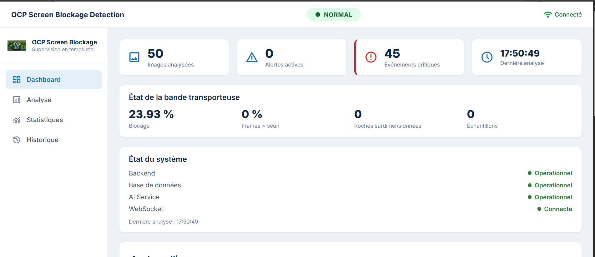
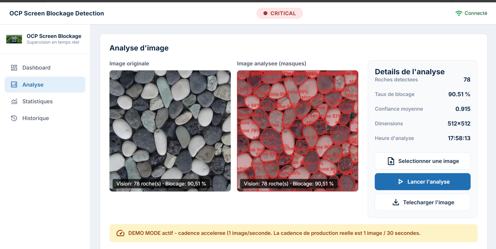
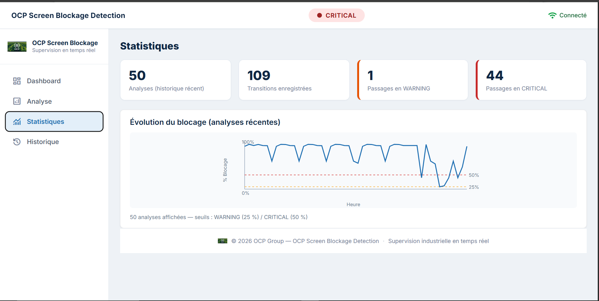

# Frontend

Tableau de bord de supervision du crible. Il affiche en temps réel l'état du système (`NORMAL`, `WARNING`, `CRITICAL`), permet d'analyser une image à la demande et conserve l'historique des changements d'état.

L'interface ne calcule rien : seuils et transitions sont gérés par le [backend](../backend). Elle se contente d'afficher l'état qu'il lui fournit, ce qui évite toute divergence entre deux écrans.



## Stack

Angular · TypeScript · Angular Material · RxJS · STOMP over WebSocket (SockJS en repli) · SCSS

## Prérequis

- Node.js et npm
- Backend démarré sur le port 8080

## Installation et lancement

```powershell
cd frontend
npm install
npm start
```

L'application est accessible sur http://localhost:4200.

## Écrans

| Page | Rôle |
|---|---|
| Supervision (dashboard) | État courant, indicateurs, dernière alerte reçue |
| Analyse | Envoi d'une image et affichage des détections, masques et dimensions |
| Historique | Liste horodatée des changements d'état |
| Statistiques | Vue agrégée des analyses et des événements |





## Fonctionnement

L'interface combine deux canaux :

- **WebSocket (STOMP)** sur le topic `/topic/status` pour la réactivité : l'écran se met à jour dès qu'une transition d'état est publiée.
- **API REST** pour l'état de référence : après chaque reconnexion, l'interface relit `GET /api/status`. Si un message a été perdu pendant une coupure, l'écran se resynchronise au lieu d'afficher une information périmée.

La connexion WebSocket est rétablie automatiquement en cas d'interruption réseau.

## Architecture

```
src/app/
├── components/   Composants réutilisables (statut, KPI, historique, superposition des détections...)
├── pages/        Pages routées : analyse, historique, statistiques
├── services/     ApiService, WebSocketService, SystemStateService, ToastService
└── models/       Types TypeScript (détection, événement, statut, message WebSocket)
```

Trois services portent l'accès aux données, et aucun composant ne contacte directement le réseau :

| Service | Rôle |
|---|---|
| `ApiService` | Appels REST vers le backend, exposés sous forme de flux RxJS |
| `WebSocketService` | Connexion STOMP, abonnement au topic d'état, reconnexion |
| `SystemStateService` | État courant partagé, diffusé à tous les composants abonnés |

Les composants ne communiquent pas entre eux : ils passent uniquement par l'état partagé. Ajouter une vue ne demande donc aucune modification des autres.

## Configuration

Les adresses du backend et du point de connexion WebSocket sont regroupées dans le fichier d'environnement Angular. Passer du poste de développement à un serveur ne demande de modifier que ce fichier, pas le code des composants.

## Tests

```powershell
npm test
```

## Limites

L'interface a été conçue à partir du besoin décrit par les exploitants, sans test avec des utilisateurs sur site. Les données affichées en démonstration proviennent d'images publiques rejouées par le simulateur de caméra.